

<h1 align="center">Omasky</h1>

  The weather moves in around your desktop, as pixel art. 
  A plugin for the <a href="https://omarchy.org">Omarchy</a> shell.

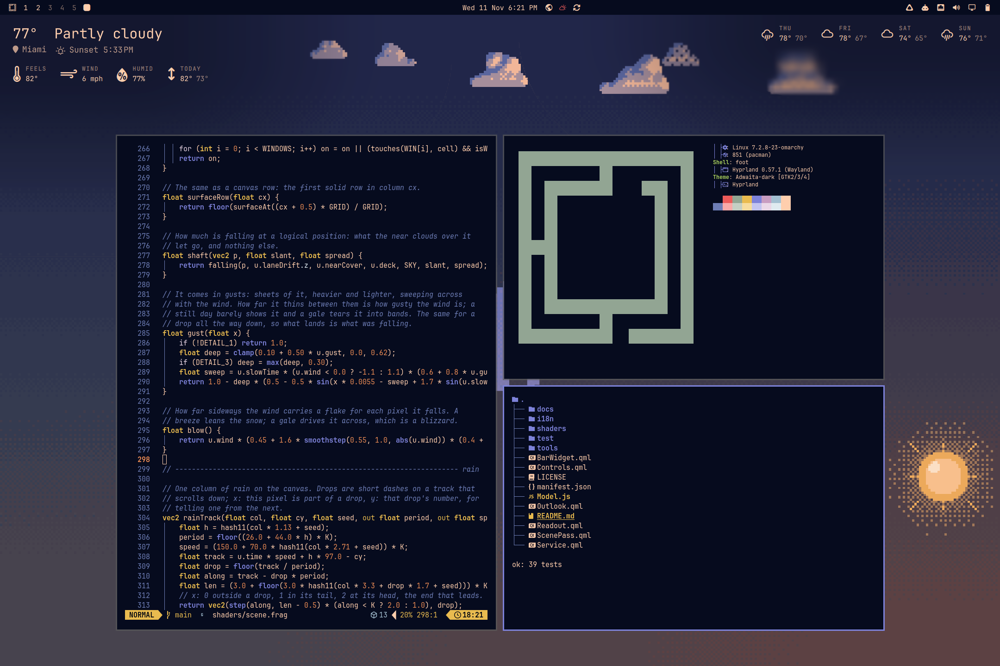

Switch it on and your workspace steps into a slightly smaller frame while a
live sky arrives around it. The windows are your real ones and work as they
always do. The weather lands on them, lies on them and runs off them, but is
never drawn over what is in them.

- **The real sky.** The sun and moon ride over the desktop by the clock, the
  moon at its real phase, with clouds crossing at the wind's speed and the
  conditions where you are, or in any city you set.
- **Weather with physics.** Rain, snow, sleet, hail, fog, lightning and
  heat. The temperature decides what falls and what becomes of it: snow
  piles up on your windows, melts in the warm and freezes into icicles in
  the cold.
- **In your theme.** Pixel art in the current theme's colors, over your
  wallpaper.
- **Out of your way.** Tiled, scrolling and floating workspaces all stay
  fully usable, and the bar icon brings the desktop straight back.

  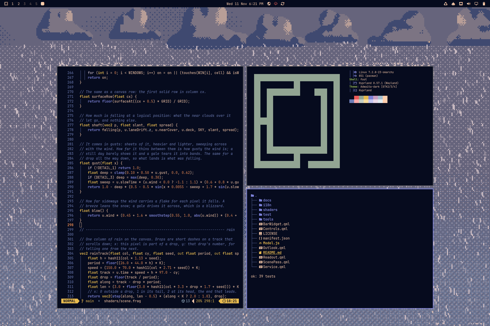
  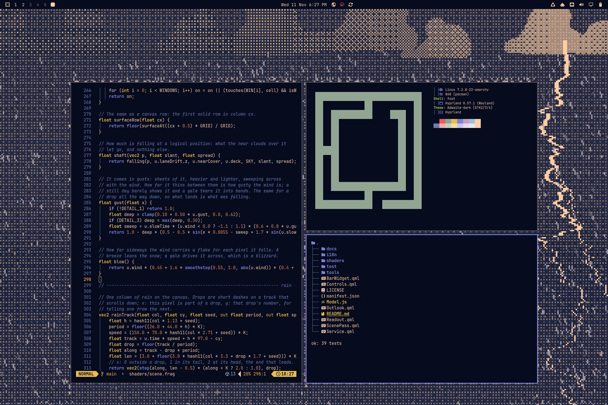

  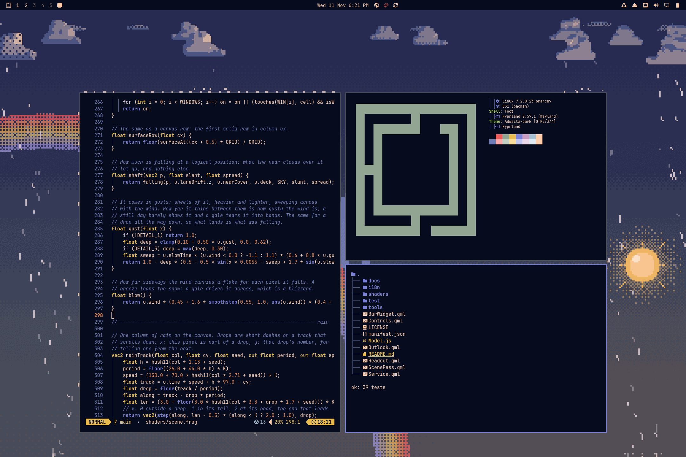
  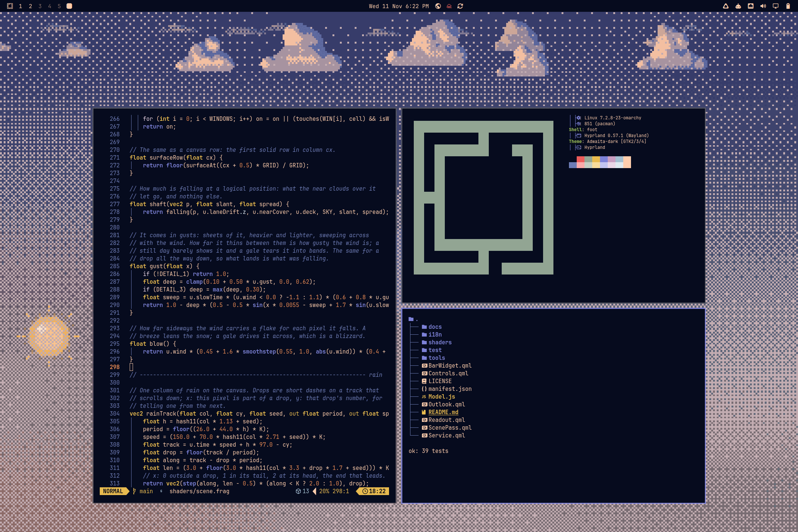

  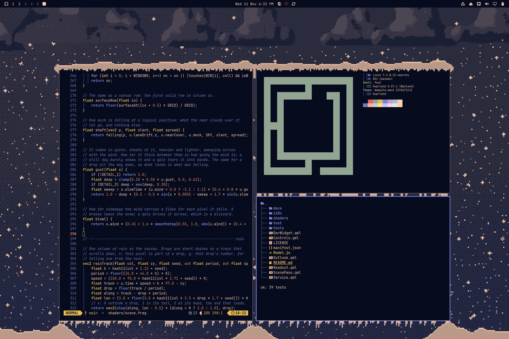
  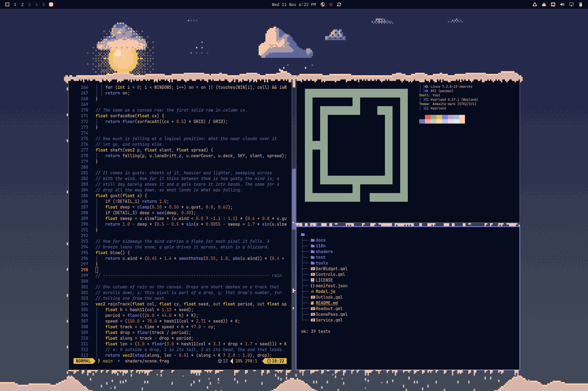

  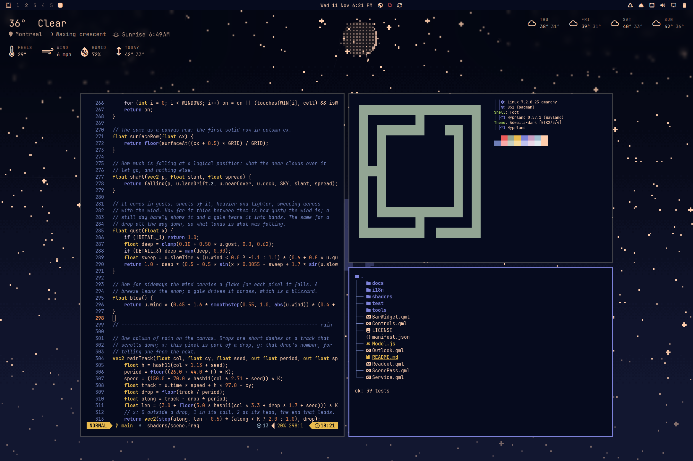
  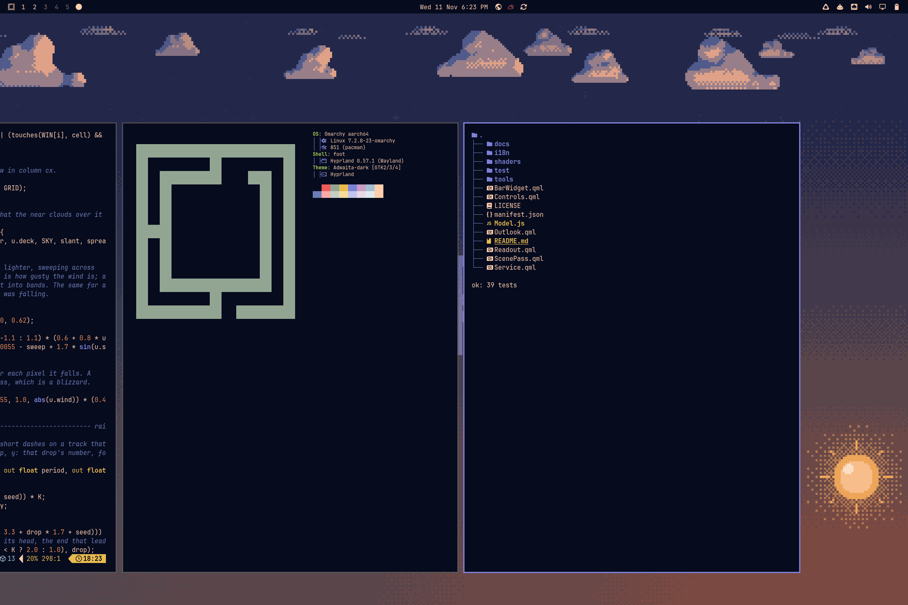

  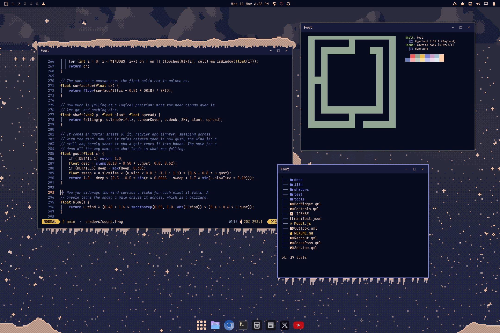
  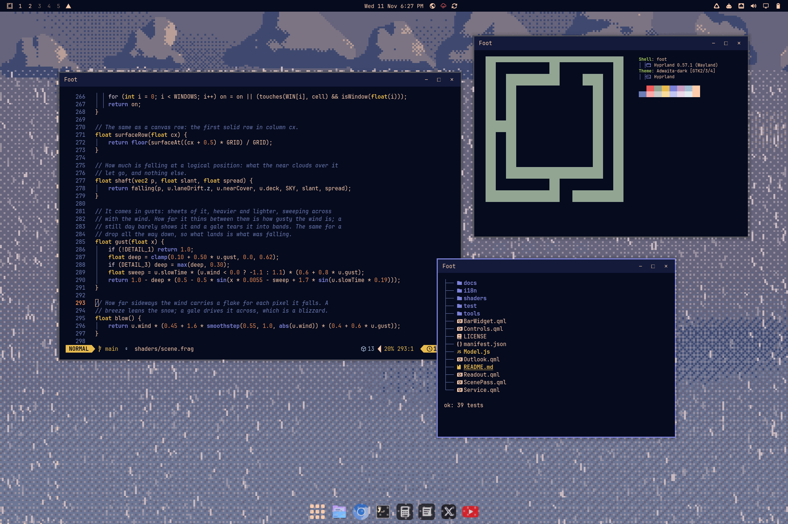

## Install

    omarchy plugin add https://github.com/cabaucom376/omasky --enable

It needs Omarchy 4 or later, on Hyprland, and nothing besides: no packages
to add, no setup script. A weather button appears in the bar beside the
clock.

    omarchy plugin update omasky && omarchy restart shell    # update
    omarchy plugin remove omasky                              # remove

## Use

| | |
|---|---|
| Click the bar icon | The sky, on and off |
| Right click | The control panel, with the sky up or without it |
| Middle click | Back to the real weather |

The icon is the weather as it is now. When rain or snow is due to start
within the hour it turns into an umbrella or a snowflake, and its tooltip
says how long there is.

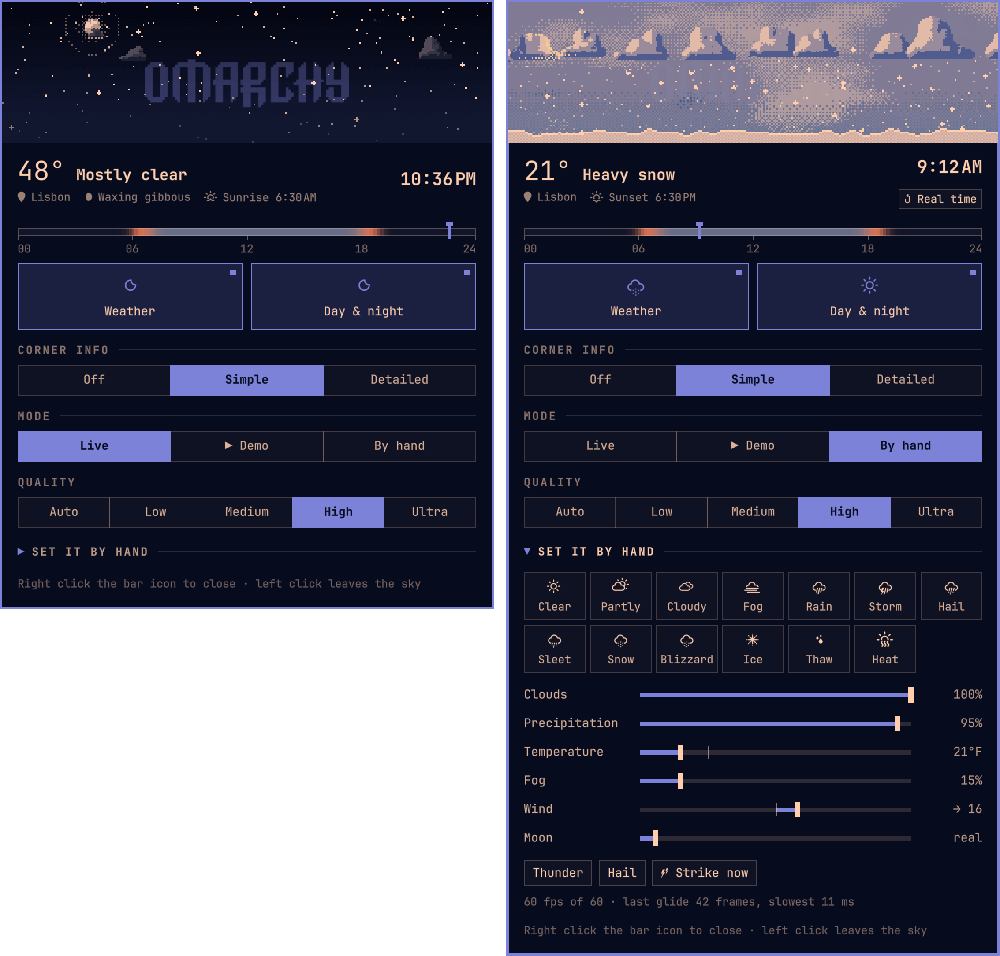

In the panel:

- **A live miniature of the sky**, and under it a ruler of the day, with
  the rain and snow forecast for each hour hanging from it. Drag it and the
  sky goes to that hour of today, with the weather forecast for it.
- **The place** the weather is for. Press it to set a city; Auto goes back
  to wherever you are.
- **Weather** and **Day & night**, each switched on its own.
- **Corner info**: off, simple, or detailed, which adds how it feels, the
  wind, the humidity and a four-day forecast.
- **Mode**: live, a demo of a whole day, or manual, with a slider for every
  part of the weather.
- **Quality**: auto, low, medium, high or ultra. On battery it draws one
  level lower.

## From a terminal

    omarchy-shell omasky toggle            # the sky, on and off
    omarchy-shell omasky city Lisbon       # where the weather is for; "auto" for where you are
    omarchy-shell omasky info detailed     # the corner info: off, simple or detailed
    omarchy-shell omasky weather off       # the weather on its own: on, off or toggle
    omarchy-shell omasky daynight off      # the sun, moon and the hour's light: on, off or toggle
    omarchy-shell omasky quality high      # auto, low, medium, high or ultra
    omarchy-shell omasky demo              # a day and a night in a minute and a half; again to stop
    omarchy-shell omasky preview storm     # try a condition: rain, snow, blizzard, fog, hail, heat, ...
    omarchy-shell omasky clock 21:30       # the sky at that hour of today, with its forecast; "now" lets it run
    omarchy-shell omasky set precip 0.8    # a manual control: clouds, precip, fog, temperature, wind, hour, moon, aurora, fireflies
    omarchy-shell omasky strike            # lightning, now
    omarchy-shell omasky live              # back to the real weather at the real time
    omarchy-shell omasky status

## Settings

Set on the bar widget, for example `omarchy bar set omasky shrink 0.7 --json`.

| Key | Default | |
|---|---|---|
| `quality` | `"auto"` | `auto` (by the machine), `low`, `medium`, `high` or `ultra` |
| `easeOnBattery` | `true` | Draw one quality level lower on battery or in power-saver mode |
| `shrink` | `0.78` | How much of the screen the windows keep each way, 0.4 to 0.94 |
| `skyOpacity` | `0.9` | The most of the wallpaper the sky covers, in the worst weather |
| `animate` | `true` | Glide in and out; `false` cuts |
| `showInfo` | `true` | The temperature and conditions in the corner of the sky |
| `infoDetail` | `false` | With them, the detail and the forecast |
| `weather` | `true` | Clouds, what falls, fog, wind and heat |
| `dayNight` | `true` | Sun, moon, stars and the sky's color by the hour |
| `headsUp` | `true` | Warn on the bar icon when rain or snow is due within the hour |
| `refreshMinutes` | `15` | How often to ask for the weather while showing |
| `unit` | `"auto"` | `"metric"` or `"imperial"` to override the locale |

## Privacy

Omasky asks `geo.omarchy.org` where you are, unless a city is set, and
Open-Meteo for the conditions there, with coordinates rounded to about a
kilometre. It does so while the sky or its control panel is showing, and,
for the warning on the bar icon, every twenty minutes or so the rest of
the time. Set `headsUp` to `false` and it asks for nothing while nothing
is on screen. A city typed into the panel goes to Open-Meteo's place search
and nowhere else. It is saved as Omarchy's own weather location, so
Omarchy's weather widget follows it too.

## More

[Omasky in detail](docs/DETAILS.md): everything the weather does, what each
quality level adds, how it stays smooth, and how to work on it.

## License

MIT. See [LICENSE](LICENSE).
